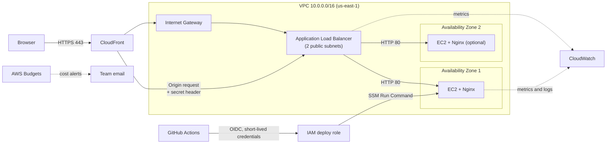

# architecture

# Architecture

Status: **Built** 
Owner: <Michael>  |  Reviewer: <Bright>  |  Last updated: 05-11-26

Related documents: [Network Plan](network-plan.md) · [Decision Log](decisions-log.md) · [Security](security.md) · [Deployment](deployment.md) · [Cost Management](cost-management.md) · [Test Matrix](test-matrix.md)

## 1. Purpose

This document describes how the MyCloudApp Restaurant Ordering System is served on AWS: what each component does, why it was chosen, how traffic and deployments flow, and what is still undecided.

The application is a React (Vite) single-page frontend. It has no backend, database or real payment processing (see Decision 001). The AWS architecture therefore only has to host and protect static files, and deliver them over HTTPS.

## 2. Design principles

1. **Simplest architecture that meets the requirements.** Every component must have a stated purpose.
2. **No public path to the origin.** Users reach the site only through CloudFront.
3. **No long-lived credentials.** Deployments use GitHub OIDC and short-lived AWS credentials.
4. **No SSH.** Administrative access uses AWS Systems Manager Session Manager.
5. **Cost-aware.** No NAT Gateway; budget alerts from day one.
6. **Claims backed by evidence.** The UI and docs report a component as working only after it has been tested.

## 3. Request path

```
Browser → HTTPS → CloudFront → ALB → EC2 (Nginx serving the React build)
```

## 4. Diagram



Exact subnet CIDRs, route tables and security group rules are in [network-plan.md](network-plan.md) and are not repeated here.

## 5. Components

| Component | Role | Essential? | Notes |
|---|---|---|---|
| CloudFront | HTTPS endpoint for users, CDN caching, hides the origin | Yes (required by project) | Viewer certificate must be in **us-east-1** if a custom domain is used |
| Application Load Balancer | Distributes traffic, runs health checks, single entry to EC2 | Yes (required by project) | Must span at least two subnets in different AZs |
| EC2 + Nginx | Serves the built React files | Yes | One instance minimum; second instance is optional (cost vs availability) |
| VPC, subnets, IGW, route table | Network foundation | Yes | No NAT Gateway |
| Security groups | Restrict who can reach ALB and EC2 | Yes | `alb-sg`, `ec2-sg` |
| IAM roles | EC2 instance profile (SSM, CloudWatch agent); GitHub OIDC deploy role | Yes | Least privilege |
| ACM | TLS certificates | Conditional | Needs a custom domain (see Section 8, O-1) |
| GitHub Actions | Build, test, deploy, smoke test | Yes | OIDC, no stored access keys |
| CloudWatch | Metrics, logs, alarms | Yes | Alarms on target health and 5xx |
| AWS Budgets | Cost alerts | Yes | Configure before creating billable resources |
| S3 | Optional artifact bucket for deployments | **Optional** | Add only if SSM-based deployment from the runner proves impractical. Not used to serve the site |

## 6. Traffic and TLS

| Hop | Protocol | Certificate |
|---|---|---|
| Browser → CloudFront | HTTPS (TLS) | Default `*.cloudfront.net` certificate, or an ACM certificate in us-east-1 for a custom domain |
| CloudFront → ALB | **Pending decision (O-1)** | HTTPS requires an ACM certificate on the ALB for a domain name you own; HTTP does not |
| ALB → EC2 | HTTP 80 | None. Traffic stays inside the VPC and is restricted by `ec2-sg` |

Region notes:

- CloudFront viewer certificates must be requested in **us-east-1**.
- A certificate attached to an ALB listener must be in the **ALB's Region**. Both are us-east-1 in this project (D-001), but they are still separate certificates unless one is reused deliberately.
- The ALB's default `*.elb.amazonaws.com` name cannot receive an ACM certificate, so an HTTPS origin connection needs a custom domain.

## 7. Origin protection

The ALB must only accept traffic that came through our CloudFront distribution. Three layers:

1. **Security group:** `alb-sg` allows inbound only from the AWS managed prefix list `com.amazonaws.global.cloudfront.origin-facing`.
2. **Secret custom header:** CloudFront adds a header with a secret value; an ALB listener rule forwards only requests that carry it and returns 403 otherwise. This closes the gap that the prefix list covers all CloudFront distributions, not just ours. The value is stored outside Git.
3. **Private instances in effect:** `ec2-sg` accepts port 80 only from `alb-sg`.

Note: S3 Origin Access Control (OAC) applies to S3 origins only. It does not protect an ALB origin, which is why the measures above are used instead.

## 8. Open decisions and known limitations

| ID | Item | Options | Impact |
|---|---|---|---|
| O-1 | CloudFront → ALB protocol | (a) HTTPS with custom domain and ACM certs; (b) HTTP to origin, no custom domain | (b) is simpler and cheaper but the origin hop is unencrypted. It also means `alb-sg` inbound must be TCP 80, not 443 as currently written in network-plan.md. Update both documents together once decided |
| O-2 | Number of EC2 instances | 1 or 2 | One instance means an AZ outage causes downtime. Two improve availability and increase cost |
| O-3 | Custom domain | Buy/use a domain or use `*.cloudfront.net` | Required for ACM-based HTTPS on the origin |
| O-4 | Deployment mechanism | SSM Run Command from GitHub Actions, or S3 artifact plus SSM | Affects whether S3 is needed |
| L-1 | EC2 public IPv4 | Instances sit in public subnets with public IPs, which AWS charges for | Check current pricing |
| L-2 | Prefix list scope | Allows any CloudFront distribution | Mitigated by the secret header (Section 7) |

Record the final choice for each open item in [decisions-log.md](decisions-log.md) and update this table.

## 9. Verification (complete in Phase 2 and 3)

A component is "Built" only when its check passes and evidence is linked.

| Component | Check | Evidence |
|---|---|---|
| EC2 + Nginx | `curl http://localhost` on the instance returns the app | Screenshot or log |
| ALB target group | Target shows **healthy** | Console screenshot |
| ALB | Request through ALB with correct header succeeds | curl output |
| Origin protection | Direct request to the ALB DNS name without the header is rejected | curl output |
| Origin protection | Direct request to the EC2 public IP on port 80 times out | curl output |
| CloudFront | Request via CloudFront URL returns the site over HTTPS | curl or browser |
| CI/CD | Push to `main` deploys and the post-deploy smoke test passes | Workflow run link |
| Monitoring | Stopping Nginx on a test instance triggers the target-health alarm | Alarm history |
| Budgets | Budget alert email received or a test notification confirmed | Screenshot |

## 10. Deployment flow

1. Developer opens a pull request; GitHub Actions runs lint, tests and the Vite build.
2. After review and merge to `main`, the deploy job assumes the IAM deploy role via GitHub OIDC (no stored keys).
3. The job delivers the build to the instance(s) and updates the Nginx web root, using SSM Run Command (see O-4).
4. A smoke test requests the CloudFront URL and checks ALB target health. The deployment is reported successful only if both pass.
5. On failure, redeploy the previous commit. See [deployment.md](deployment.md) for the rollback procedure.

## 11. Monitoring and cost controls

- **CloudWatch metrics and alarms:** ALB `UnHealthyHostCount`, ALB target 5xx count, EC2 status check failed.
- **Logs:** Nginx access and error logs via the CloudWatch agent, with a limited retention period to control cost.
- **AWS Budgets:** monthly cost budget with email alerts at defined thresholds, created before other resources.
- **Cost drivers to check against current pricing:** ALB, EC2 instance hours, public IPv4 addresses, CloudFront data transfer, CloudWatch logs. Do not assume Free Tier covers them. Estimates belong in `docs/cost-estimate.md`.

## 12. Security summary

- HTTPS between users and CloudFront.
- Only CloudFront can reach the ALB; only the ALB can reach EC2.
- No inbound SSH; Session Manager for administration.
- No AWS credentials, keys or tokens in the repository.
- IAM roles scoped to the minimum required actions.
- The application does not collect real payment or sensitive personal data (Decision 001, Section 9).

Full review in [security.md](security.md).

## 13. Out of scope

Backend API, database, authentication, real payments, private subnets with NAT, WAF, auto scaling, multi-Region deployment. These are possible future improvements and are not part of the demonstrated system.
