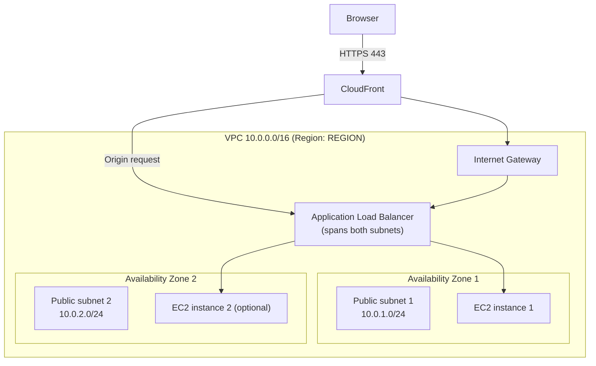

# Network Plan

Status: **Planned, not yet built** (update to "Built" once verified in Phase 2)
Owner: <name>  |  Reviewer: <name>  |  Last updated: <date>

## 1. Request path

Browser → HTTPS → CloudFront → ALB → EC2 (Nginx)

## 2. Diagram

## 3. Addressing

| Resource | Value | Notes |
|---|---|---|
| Region | US virginia | Chosen in decision log (D-001) |
| VPC CIDR | 10.0.0.0/16 | |
| Public subnet 1 | 10.0.1.0/24 in <AZ-1> | ALB + EC2 |
| Public subnet 2 | 10.0.2.0/24 in <AZ-2> | ALB + EC2 |
| Internet Gateway | 1, attached to VPC | |
| Route table | 0.0.0.0/0 → Internet Gateway | Associated with both subnets |
| NAT Gateway | None | Avoided for cost |

## 4. Security groups

### alb-sg (attached to the ALB)

| Direction | Protocol/Port | Source / Destination | Purpose |
|---|---|---|---|
| Inbound | TCP 443 | AWS managed prefix list `com.amazonaws.global.cloudfront.origin-facing` | Only CloudFront can reach the ALB |
| Outbound | TCP 80 | ec2-sg | Forward to instances |

### ec2-sg (attached to the EC2 instances)

| Direction | Protocol/Port | Source / Destination | Purpose |
|---|---|---|---|
| Inbound | TCP 80 | alb-sg | Only the ALB can reach Nginx |
| Outbound | TCP 443 | 0.0.0.0/0 | Package updates, SSM, CloudWatch agent |

No inbound SSH (port 22). Admin access uses Session Manager.

## 5. Known limitations and open decisions

- Origin protocol (CloudFront → ALB): HTTPS needs an ACM certificate on the ALB, which requires a custom domain. Decision pending: see D-00X.
- The CloudFront prefix list allows any CloudFront distribution, not only ours. Mitigation: a secret custom header added by CloudFront and checked by an ALB listener rule.
- EC2 instances have public IPv4 addresses, which AWS charges for. Check current pricing.
- Single AZ failure: with one instance, an AZ outage means downtime. Two instances improve availability but cost more.

## 6. Cost notes

- VPC, subnets, route tables, IGW, security groups: no charge.
- ALB: hourly and usage charges. Check current pricing for the chosen Region.
- EC2 and public IPv4: charged. Verify Free Tier eligibility on the account.
- Estimate in `docs/cost-estimate.md` using the AWS Pricing Calculator.

## 7. Verification checklist (complete in Phase 2)

- [ ] Both subnets are in different AZs
- [ ] Route table has a 0.0.0.0/0 route to the IGW
- [ ] ec2-sg has no inbound rule from 0.0.0.0/0
- [ ] Direct request to the EC2 public IP on port 80 times out
- [ ] Direct request to the ALB DNS name is blocked or rejected
- [ ] Request through CloudFront returns the site
