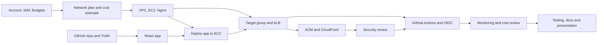

# Workload

Status: **Initial framework. Names, skills, availability and deadlines confirmed.** 

Related documents: [Architecture](architecture.md) · [Decision Log](decisions-log.md) · [Test Matrix](test-matrix.md) · [Cost Management](cost-management.md) · [Security](security.md)

## 1. Purpose

This document explains how the team divides work, tracks effort, and moves ownership when availability changes. It exists so that:

- every task has exactly one accountable owner,
- uneven workload is visible and agreed, not hidden,
- no critical component depends on a single person,
- the final presentation can describe who actually did what.

Trello is the source of truth for task status. This document defines the rules and holds the summary tables.

## 2. Principles

1. **One owner per task.** Others may support or review, but one person is accountable.
2. **Workload need not be equal.** One team member has more availability and is expected to take on more implementation over time. That is acceptable if it is recorded and the other members still have meaningful work.
3. **Estimates and actuals are both recorded.** Plans change; the record shows how.
4. **Ownership changes go through Trello.** Nobody takes over a task silently.
5. **Knowledge is shared.** Every critical component has a backup person who can explain and operate it.
6. **No misrepresentation.** Work is credited to the person who did it. Partly finished work is shown as partly finished.
7. **Every member contributes visibly.** The presentation requires each person to present something they actually worked on.

## 3. Team roster (to complete)

Do not assign tasks to real people until this table is filled in.

| Member | Name | Skills and experience | Weekly availability (hours) | Known unavailable dates | Notes |
|---|---|---|---|---|---|
| A | Philipa | Coordination, integration, architecture | | | |
| B | Michael | Frontend and user interface | | | |
| C |  Philip | AWS infrastructure and networking | | | |
| D | Bright | CI/CD, testing, automatio | | | |
| E | Sandra |  monitoring, documentation, QA | | | |

Project deadline: `04-11-2026`  |  Final presentation: `<06-11-2026`  |  Team check-in schedule: `2 times/day`

## 4. Suggested initial responsibility areas

These are starting points, not permanent roles. 

### 4.1 Team of five

| Member | Area | Examples of primary ownership |
|---|---|---|
| A | Coordination, integration, architecture | Trello board, decision log, architecture.md, integration between workstreams, presentation structure |
| B | Frontend and user interface | React app, responsive design, frontend tests, status cards |
| C | AWS infrastructure and networking | VPC, subnets, security groups, EC2, ALB, CloudFront, ACM |
| D | CI/CD, testing, automation | GitHub Actions, OIDC role, deployment scripts, smoke tests, test-matrix.md |
| E | Security, monitoring, documentation, QA | security.md, CloudWatch, Budgets, IAM review, troubleshooting.md, README |

## 6. Tracking workload

### 6.1 Per-card fields in Trello

Each card carries: owner, supporting members, estimate (S/M/L), actual effort (hours, updated on completion), status list, due date if known, dependencies, and evidence link. Use a custom field or a standard line in the description such as `Estimate: M | Actual: 3h`.

### 6.2 Summary table (update weekly)

Fill from Trello. Do not enter figures that are not in Trello.

| Member | Cards owned | Cards done | Estimated effort (hrs) | Actual effort (hrs) | Available hrs this week | Backup for | Notes |
|---|---|---|---|---|---|---|---|
| A | | | | | | | |
| B | | | | | | | |
| C | | | | | | | |
| D | | | | | | | |
| E | | | | | | | |

### 6.3 Weekly review (15 minutes, led by the coordinator)

1. Update the summary table from Trello.
2. Compare each person's open estimated effort with their available hours.
3. Flag anyone who is overloaded (more estimated work than available time) or underused.
4. Check blocked cards and the next action for each.
5. Decide any reallocation and record it (Section 7).
6. Check that each member is on track to have something to present.

### 6.4 Warning signs

| Sign | Likely action |
|---|---|
| One person owns more than about half of all open cards | Check whether intended; move small or well-defined tasks to others, or add a backup/reviewer |
| A person's open estimate exceeds available hours for two weeks | Reassign or reduce scope |
| A critical card has no backup | Assign one (Section 8) |
| A card has been In Progress with no update for several days | Ask for status; mark Blocked if needed |
| Actual effort is consistently double the estimate | Recalibrate the scale and revisit the schedule |
| Someone has only review or documentation tasks | Pair them on an implementation task |

## 7. Reassigning work

### 7.1 When to reassign

A member's availability changes; a task is blocked on skills; someone is overloaded; or a member with more availability takes over implementation.

### 7.2 Procedure

1. The coordinator (or the current owner) proposes the change in the team channel.
2. The current owner **documents completed work** on the card: what is done, where the code or configuration lives (branch, pull request, commit), and what remains.
3. Update the card: new owner, supporting members, status, remaining checklist items, and a new estimate for the remaining work.
4. Add a comment: `Reassigned from <old owner> to <new owner> on <date>. Reason: <reason>.`
5. The new owner confirms on the card that they have accepted it.
6. If the change affects architecture or scope, add an entry to the [decision log](decisions-log.md).
7. Update the summary table in Section 6.2.

Do not leave two people each assuming the other owns the task. Until the new owner confirms, the original owner remains accountable.

### 7.3 Handoff checklist

Copy into the Trello card when reassigning.

- [ ] Current status described (done / in progress / not started)
- [ ] Work completed so far credited to the original owner
- [ ] Branch, pull request or commit links added
- [ ] Remaining subtasks listed
- [ ] Known issues, blockers and decisions made so far recorded
- [ ] Any AWS resources created listed (names and IDs) with tags set
- [ ] Credentials or access needed explained **without sharing secrets in the card** (access is granted through IAM, not passed along)
- [ ] Walkthrough done (call or pairing session)
- [ ] New owner confirmed
- [ ] New estimate and due date set
- [ ] Reviewer or backup updated if affected

### 7.4 Taking on a larger share

When the most available member takes over tasks:

- Tightly coupled infrastructure tasks (for example VPC, subnets, route tables, security groups) should move **together**, with an integration note, rather than being split across people.
- The original owner stays as reviewer or backup for tasks they started so knowledge is not lost.
- The presentation records the real split of work (Section 11).

## 8. Backup and review coverage

Complete this table once names are confirmed. For critical components the backup should be a **different person from the owner** and able to explain and operate the component.

| Component | Primary owner | Backup | Reviewer | Notes |
|---|---|---|---|---|
| Trello board and decision log | Philipa | | | |
| React application | Michael | | Bright | |
| VPC, subnets, security groups | Philip | Philipa | Bright | Move as a group |
| EC2 and Nginx | Philip | Philipa | Bright | |
| ALB and target group | Philip | Philipa| Bright | |
| CloudFront and ACM | Philip | Philipa | Bright | |
| GitHub repository and branch protection | Bright | | | |
| GitHub Actions and OIDC role | Bright | Philip | | Highest security impact |
| IAM and account access | Bright |  Philip | | Root account recovery path documented |
| CloudWatch alarms | Sandra | Michael | | Move as a group |
| AWS Budgets and cost review | Sandra| | | |
| Documentation set | Sandra | | Philipa | |
| Presentation and demo | Philipa | | | Demo needs a second operator |

## 9. Suggested task allocation by phase (area level)

These are task areas, not assignments to people. Names are added in Trello after the roster is confirmed. Each card still needs its own acceptance criteria, dependencies and evidence.

| Phase | Work areas | Typical lead area | Reviewer area |
|---|---|---|---|
| 1 | Account, IAM, MFA, Region confirmation | Infrastructure / Security | Coordination |
| 1 | GitHub repo structure, branching, branch protection | CI/CD | Coordination |
| 1 | Trello board, labels, first cards | Coordination | Any |
| 1 | Network plan and cost estimate | Infrastructure | Security |
| 1 | AWS Budgets and billing alerts | Security / Cost owner | Coordination |
| 2 | React app development | Frontend | CI/CD (build check) |
| 2 | VPC, subnets, security groups, EC2, Nginx | Infrastructure | Security |
| 2 | Target group, ALB, health checks | Infrastructure | CI/CD |
| 2 | Functional and responsive tests | Frontend / QA | Coordination |
| 3 | ACM, CloudFront, origin protection | Infrastructure | Security |
| 3 | Security review and verification checklist | Security | Coordination |
| 4 | GitHub Actions, OIDC role, deploy and smoke test | CI/CD | Security |
| 4 | CloudWatch logs and alarms | Security / Monitoring | Infrastructure |
| 4 | Cost review | Cost owner | Coordination |
| 5 | End-to-end validation and test matrix completion | CI/CD / QA | Coordination |
| 5 | README, troubleshooting, deployment guide | Documentation | Infrastructure |
| 5 | Slides, speaker notes, demo rehearsal | Coordination (all present) | Any |

Parallel work is usually possible between the frontend and the infrastructure streams in Phase 2. CI/CD needs a working deployment target and a built app first, so it depends on both.

## 10. Task dependency overview

Treat this as the starting map. Update it when the team splits or merges tasks.

## 11. Risks

| ID | Risk | Mitigation |
|---|---|---|
| W-1 | Most availability sits with one person, creating a single point of knowledge | Backups and reviewers (Section 8); pairing; documentation as work is done |
| W-2 | A member becomes unavailable unexpectedly | Handoff checklist; keep Trello current so tasks can be picked up |
| W-3 | Beginners are left only with easy or documentation tasks | Pair on implementation; give each member one meaningful technical deliverable |
| W-4 | Estimates are wrong early on | Record actuals; recalibrate after the first few cards |
| W-5 | Tightly coupled infrastructure is split without coordination | Move related cards together with an integration note |
| W-6 | Unfinished work is described as complete in the presentation | Contribution record from Trello and Git; evidence required for Done |

## 12. Open items

- [ ] Collect names, skills, availability, known unavailable dates and the project deadline (Section 3)
- [ ] Decide team size (four or five) and confirm the responsibility areas
- [ ] Identify who has the greater availability and agree how that affects task ownership
- [ ] Choose how effort is recorded in Trello (custom field or description line)
- [ ] Fill in the backup and review table (Section 8)
- [ ] Schedule the weekly review
- [ ] Create the first Trello cards from Section 9 once owners are agreed
